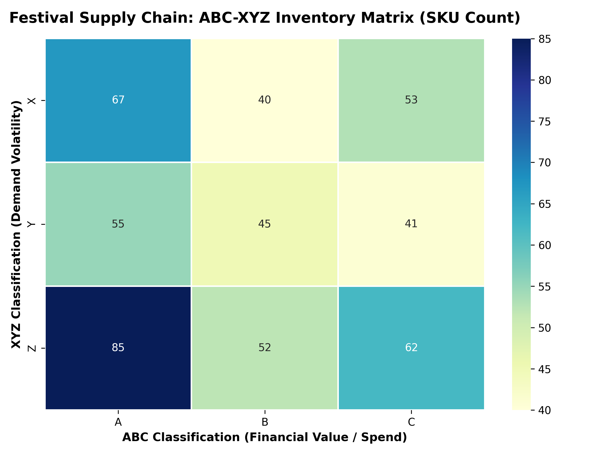

# 🎪 Festival Inventory War Room: Supply Chain Analytics

An end-to-end supply chain engineering project optimizing stock allocation, safety stock, and reorder points for a 100,000-attendee music festival across 500 SKUs.

---

## 📌 Executive Summary
- **Total SKUs Tracked:** 500 Inventory Items
- **Class A Items (Top 80% Capital Spend):** 207 SKUs
- **Critical Reorder Alerts:** 313 SKUs below Reorder Point (ROP)
- **Service Level Target:** 95% Availability ($Z = 1.645$)

---

## 🛠️ Project Structure

---

## 📊 ABC-XYZ Matrix Visualization
Below is the 3x3 matrix showing inventory allocation across financial value (A/B/C) and demand volatility (X/Y/Z):

---

## 🔗 Interactive Executive Dashboard
👉 **[View Interactive Tableau War Room Dashboard](https://prod-ch-a.online.tableau.com/t/mosestv2244-638548aa76/authoring/FestivalInventoryWarRoom/Dashboard1#1)**